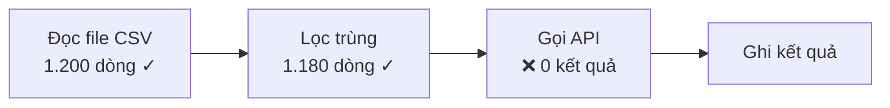

# fix-loop-breaker

Thoát vòng "bảo AI sửa mãi mà lỗi vẫn còn".

Sửa cả ngày không xong hiếm khi do AI kém. Thường là vì nó **đoán nguyên nhân rồi vá luôn, không đo**.
Vá sai thì nó vá thêm một lớp nữa lên trên. Code càng rối, cuộc chat càng đầy những lần sửa hỏng,
nên lần đoán sau càng sai. Skill này cắt vòng đó bằng 6 bước theo đúng thứ tự, mỗi bước có cổng chặn:
chưa qua cổng thì không sang bước sau.

```
0 Tái hiện ─► 1 Ba lăng kính ─► 2 Hai AI ─► 3 Spec ─► 4 Sơ đồ mới + code ─► 5 Kiểm thật
                   ▲                                                          │
                   └──────────── vẫn hỏng: quay lại với sự thật mới ──────────┘
```

---

## Khi nào dùng

Bắt buộc dùng khi gặp **một trong bốn** điều sau, không chờ cảm giác "hình như đang luẩn quẩn":

- Người dùng **báo có lỗi**: "lỗi rồi", "tool lỗi", "fix lỗi", "không chạy", "ra sai", "error", "bug"...
- Sửa **cùng một file hoặc cùng một bộ phận lần thứ 2** cho cùng một loại lỗi
- Một lỗi đã kéo **quá 60 phút**
- Người dùng nói kiểu "lâu thế", "luẩn quẩn", "vẫn chưa xong", "lại lỗi đó"

**Đường tắt cho lỗi vặt:** mọi lỗi đều bắt đầu từ bước 0. Nếu bước 0 đã lộ rõ nguyên nhân (thiếu thư
viện, sai đường dẫn, thiếu key, sai phiên bản) thì sửa luôn rồi nhảy sang bước 5 để kiểm. Đã đi đường
tắt mà vẫn hỏng thì quay lại bước 1, không đi đường tắt lần thứ hai.

**Quyền DỪNG:** từ lúc skill này chạy, **cấm vá theo đoán**. Chỉ được sửa code khi bước 0 đã lộ rõ
nguyên nhân (đường tắt), hoặc sau khi xong bước 3. Mọi lần "thử sửa nhanh cái này xem sao" trong lúc
chưa rõ nguyên nhân chính là cái vòng mà skill này sinh ra để cắt.

---

## Bước 0. Tái hiện lỗi và gom sự thật

Không có sự thật thì 3 lăng kính chỉ là suy luận trên đồ đoán, và AI thứ hai cũng đoán theo.

Ghi vào `FIX-NOTES.md` ở gốc dự án:

| Mục | Cần có |
|---|---|
| Lỗi nguyên văn | dán đúng thông báo lỗi, stack trace, hoặc mô tả "mong A, ra B" kèm số |
| Lệnh tái hiện | một lệnh hoặc một chuỗi thao tác, chạy là ra lỗi |
| Đầu vào gây lỗi | file, dữ liệu, URL cụ thể |
| Môi trường | phiên bản ngôn ngữ, thư viện, hệ điều hành, biến môi trường liên quan (chỉ ghi TÊN biến, không ghi giá trị khoá) |
| Bản còn chạy được | commit hoặc phiên bản cuối cùng chạy đúng (`git log`, `git bisect` nếu cần) |
| Đã thử những gì | mỗi lần thử **một dòng**: đã đổi gì → kết quả. Không dán lại cả lịch sử chat |

**Cổng:** có một lệnh chạy ra đúng lỗi. Chưa tái hiện được thì việc đầu tiên là thêm log hoặc in giá trị
thật ra cho tới khi tái hiện được. Không tái hiện được thì cũng không có cách nào chứng minh đã sửa xong.

Hay gặp: tới bước này thì lỗi đã lộ nguyên nhân (sai phiên bản, sai đầu vào, cache cũ). Khi đó nhảy
thẳng sang bước 5.

---

## Bước 1. Ba lăng kính, kèm sơ đồ luồng HIỆN TẠI

### 1a. Vẽ sơ đồ luồng hiện tại

Vẽ bằng Mermaid: dữ liệu đi từ đâu, qua những bước nào, ra đâu. **Đánh dấu chỗ hỏng bằng số đo**
(giá trị thật in ra ở mỗi bước), không phải bằng "có lẽ ở đây".



Chưa có số ở một bước thì việc đầu tiên là đo bước đó.

### 1b. Lăng kính 1: nguyên lý gốc

Lập ba cột:

| Sự thật (đã đo, đã thấy) | Giả định (đang tin nhưng chưa kiểm) | Ràng buộc thật (không đổi được) |
|---|---|---|

Mỗi giả định ghi kèm **cách kiểm** và **kiểm luôn những cái rẻ**. Phần lớn lỗi kéo dài cả ngày nằm ở
một giả định chưa ai kiểm: "API trả đúng định dạng", "file này được đọc", "hàm này có chạy tới".

Rồi suy ngược từ các sự thật lên giải pháp, không suy theo kiểu "người khác làm thế nên mình làm thế".

### 1c. Lăng kính 2: bóc cấu trúc, tìm chỗ tắc THẬT

Dựa vào sơ đồ 1a, chỉ ra **một** chỗ tắc kèm số đo. Sửa ở chỗ không tắc thì sửa cả ngày cũng không
nhanh hơn, không đúng hơn.

### 1d. Lăng kính 3: đúng thứ tự

**Hỏi lại yêu cầu → Xoá → Đơn giản hoá → Tăng tốc → Tự động hoá.** Đi đúng thứ tự này:

1. Yêu cầu nào đang gây khó? Ai cần nó, có thật cần không?
2. Bước nào **xoá** được? Lỗi hay gặp nhất là cố sửa một bước lẽ ra phải xoá.
3. Phần còn lại đơn giản hoá thế nào?
4. Chỉ sau đó mới nghĩ tới nhanh hơn hay tự động hơn.

**Cổng:** viết được 3 dòng:
1. Giả định nào chưa từng kiểm (và đã kiểm được những cái nào)
2. Chỗ tắc nằm ở đâu, kèm số đo
3. Bước nào xoá được, và một thử nghiệm dưới 15 phút để chứng minh

---

## Bước 2. Hai AI cùng tìm phương án

Một AI đã kẹt trong vòng thì hay bám vào cách nghĩ cũ. Thêm một AI khác, ví dụ đang dùng Claude thì
hỏi thêm Codex, Gemini hoặc ChatGPT, và ngược lại.

Luật:

- **Đưa SỰ THẬT, không đưa lịch sử.** Đưa `FIX-NOTES.md`, sơ đồ, 3 dòng ở bước 1, các `file:dòng` liên
  quan. Không dán cả cuộc chat sửa hỏng, vì nó kéo AI thứ hai vào đúng cái vòng cũ.
- **AI thứ hai chỉ đọc, không sửa.** Nó đề xuất, không động vào code.
- **AI thứ hai không phải trọng tài.** Hai bên khác nhau thì không chọn bên nói tự tin hơn. Chọn bằng
  một **thử nghiệm dưới 15 phút** cho ra số.

Mẫu câu hỏi cho AI thứ hai:

```
Đây là một lỗi đã sửa nhiều lần không xong. Chỉ đọc, không sửa file.
SỰ THẬT: <dán FIX-NOTES.md>
SƠ ĐỒ: <dán mermaid>
CHỖ TẮC ĐÃ ĐO: <dòng 2 của bước 1>
FILE LIÊN QUAN: <file:dòng>
Hỏi: (1) nguyên nhân gốc theo bạn là gì, giả định nào bạn nghi nhất;
(2) bước nào XOÁ được thay vì sửa; (3) một thử nghiệm < 15 phút phân biệt giả thuyết của bạn với giả thuyết sau: <giả thuyết của AI thứ nhất>.
```

### 2a. Kiểm xem máy đã có AI thứ hai chưa

Agent tự chạy, không hỏi người dùng:

```bash
codex --version      # có số phiên bản = đã có Codex CLI
node --version       # Codex cần Node.js 18.18 trở lên
```

Và xem trong danh sách lệnh của Claude Code có `/codex:setup`, `/codex:review` chưa (có = đã cài plugin Codex).

| Tình trạng | Làm gì |
|---|---|
| Có Codex CLI | Gọi thẳng ở chế độ chỉ đọc (mục 2c) |
| Có plugin Codex trong Claude Code | Nhờ người dùng gõ `/codex:adversarial-review` kèm câu hỏi ở trên, hoặc gọi CLI như mục 2c |
| Chưa có gì | Hướng dẫn cài (mục 2b). Người dùng chưa muốn cài thì dùng đường dự phòng (mục 2d) |

### 2b. Cài Codex lần đầu (cho người chưa biết)

Codex là AI lập trình của OpenAI. Dùng được bằng tài khoản ChatGPT (kể cả gói Free) hoặc API key của OpenAI,
lượt dùng tính vào hạn mức Codex của tài khoản đó.

Giải thích ngắn cho người dùng vì sao cần (một AI khác, không dính cách nghĩ của phiên đang kẹt), **hỏi họ có
đồng ý cài không**, rồi đi từng bước:

1. **Cài Codex CLI.** Máy có `npm` thì agent tự chạy được (sau khi người dùng đồng ý):
   ```bash
   npm install -g @openai/codex
   ```
   Chưa có Node.js thì nhờ người dùng cài bản LTS ở https://nodejs.org trước.
2. **Đăng nhập.** Bước này cần người dùng tự làm vì phải mở trình duyệt. Trong Claude Code, bảo họ gõ:
   ```
   ! codex login
   ```
3. **(Tuỳ chọn) Cài plugin Codex cho Claude Code**, để có sẵn các lệnh `/codex:review`,
   `/codex:adversarial-review`, `/codex:rescue`. Agent không tự gõ được lệnh có dấu `/`, nên nhờ người dùng
   gõ lần lượt:
   ```
   /plugin marketplace add openai/codex-plugin-cc
   /plugin install codex@openai-codex
   /reload-plugins
   /codex:setup
   ```
   `/codex:setup` báo Codex đã sẵn sàng chưa. Nếu thiếu Codex mà máy có npm, nó cũng tự đề nghị cài.
4. **Kiểm lại:** `codex --version` ra số phiên bản, và một lệnh thử ở mục 2c chạy ra chữ (không báo lỗi đăng
   nhập), thì mới tính là cài xong.

### 2c. Gọi Codex ở chế độ chỉ đọc

Lưu câu hỏi ở trên vào `prompt.txt`, chạy nền (thường mất 5 đến 10 phút):

```bash
codex exec --skip-git-repo-check -s read-only -C "<thư mục dự án>" - < prompt.txt > codex-out.txt
```

`-s read-only` bảo đảm Codex chỉ đọc, không sửa file. Trong lúc chờ, agent tự làm phần phân tích của mình.
Codex xong thì đặt hai ý cạnh nhau.

### 2d. Đường dự phòng khi không cài được Codex

- **Một phiên Claude mới, context sạch:** gọi một subagent mới (hoặc mở một cửa sổ Claude Code khác) và chỉ
  đưa `FIX-NOTES.md`, sơ đồ và câu hỏi ở trên. Cùng một model nhưng không mang theo lịch sử sửa hỏng thì vẫn
  nhìn ra được điều phiên đang kẹt bỏ sót.
- **Một AI khác trên web:** dán câu hỏi ở trên vào ChatGPT, Gemini hoặc Claude ở một cửa sổ khác, rồi dán câu
  trả lời lại cho agent.

**Cổng:** có một phương án được chọn, kèm lý do và kết quả thử nghiệm phân xử (nếu hai bên lệch nhau).
Báo người dùng **cả hai ý**, kể cả ý không được chọn.

---

## Bước 3. Viết lại spec

Lỗi kéo dài cả ngày thường là vì spec ban đầu mơ hồ hoặc sai, AI cứ code theo cái sai đó mãi. Viết lại
vào `SPEC.md` (hoặc sửa spec cũ):

```markdown
## Mục tiêu         — một câu: tool này làm gì cho ai
## Đầu vào          — định dạng, ví dụ thật
## Đầu ra           — định dạng, ví dụ thật
## Luồng            — các bước, khớp với sơ đồ mới ở bước 4
## Đã xoá           — những bước/yêu cầu bỏ đi ở bước 1, và lý do
## Ràng buộc        — giới hạn API, thời gian, chi phí...
## Nghiệm thu       — điều kiện "chạy đúng", đo được. BẮT BUỘC có:
                      - lệnh tái hiện ở bước 0 không còn ra lỗi
                      - một lần chạy với đầu vào thật, kết quả mong đợi bằng số
## Ngoài phạm vi    — những gì lần này không làm
```

**Cổng:** mục Nghiệm thu có ít nhất một điều kiện đo được và chứa ca lỗi của bước 0. Có chỗ phải để người
dùng chốt (bỏ tính năng, đổi hướng) thì hỏi họ ở đây, không tự quyết.

---

## Bước 4. Sơ đồ luồng MỚI, rồi mới code

1. Vẽ sơ đồ luồng mới bằng Mermaid, đặt cạnh sơ đồ cũ để thấy rõ bước nào bị xoá, bước nào thay.
2. Lưu lại trạng thái hiện tại trước khi sửa (`git commit` hoặc `git stash`), để quay lại được.
3. Code theo spec. Phần bị hỏng thì **viết lại theo spec** thay vì vá tiếp lên code đã sửa nhiều lần.
4. Đi từng bước nhỏ, mỗi bước chạy được thì mới làm bước tiếp.

**Cổng:** code khớp sơ đồ mới; không có bước nào trong code mà không có trong sơ đồ.

---

## Bước 5. Kiểm thật

AI code xong rồi tự báo "đã sửa" thì **chưa tính là xong**. Đó chính là cách vòng lặp bắt đầu.

1. Chạy **lệnh tái hiện ở bước 0**. Phải hết lỗi.
2. **Đối chứng âm:** chạy cùng phép thử đó trên bản cũ (hoặc bỏ phần vừa sửa). Bản cũ phải **hỏng**.
   Bản cũ cũng qua nghĩa là phép thử không đo đúng thứ cần đo, và "đã sửa" là giả.
3. Chạy với **đầu vào thật**, đúng như điều kiện Nghiệm thu trong spec.
4. **Người dùng nhìn kết quả bằng mắt**: con số, màn hình, file đầu ra. Agent báo cáo những gì đã chạy
   và thấy gì, không chỉ nói "pass".

**Hỏng:** quay lại **bước 1** (không phải bước 4) với những sự thật mới vừa đo được, ghi thêm vào
`FIX-NOTES.md`. Quay lại bước 1 lần thứ 2 mà vẫn hỏng thì dừng hẳn, báo người dùng: đã biết gì,
còn nghi gì, cần họ quyết gì.

**Đạt:** ghi một bài học vào `LESSONS.md` của dự án: lỗi trông thế nào, gốc thật là gì, lần sau nhận
ra sớm bằng dấu hiệu nào. Bẫy cắn từ 2 lần trở lên thì đáng đưa vào luật của dự án (`CLAUDE.md`,
`AGENTS.md`...).

---

## Bẫy đã gặp

| Bẫy | Trông thế nào | Chặn bằng |
|---|---|---|
| Vá chồng vá | mỗi lần sửa thêm một `if`, một `try/catch`, một lần thử lại | Quyền DỪNG; bước 1d hỏi "xoá được gì" |
| AI tự báo xong | "Đã sửa xong, giờ chạy được rồi" mà không có lệnh nào được chạy | Bước 5: chạy lại ca lỗi, người nhìn kết quả |
| Phép thử giả | lần chạy thứ 2 luôn qua vì cache; test không chạm tới chỗ hỏng | Bước 5.2: đối chứng âm, bản cũ phải hỏng |
| Lỗi bị nuốt | công cụ trả "thành công" hoặc kết quả rỗng trong khi thật ra đã lỗi | Bước 1a: đo giá trị thật ở từng bước, không tin trạng thái báo về |
| Mở chat mới mà dán cả lịch sử | AI mới lặp lại đúng các hướng sai cũ | Bước 2: chỉ đưa `FIX-NOTES.md` và sơ đồ |
| Chọn phương án theo độ tự tin | AI nói chắc nịch nên làm theo | Bước 2: thử nghiệm < 15 phút phân xử |
| Sửa ở chỗ không tắc | tối ưu một bước vốn chạy đúng | Bước 1c: chỉ ra chỗ tắc kèm số đo |

---

## Báo cáo cho người dùng

Sau mỗi bước, báo ngắn gọn:

```
Bước <n> xong.
- Thấy gì: <sự thật mới, kèm số>
- Quyết gì: <lựa chọn + lý do>
- Tiếp theo: <bước kế>
- Cần anh/chị: <việc cần người dùng quyết, hoặc "không">
```

Lần cuối báo: lỗi gốc là gì, đã xoá gì, đã đổi gì trong spec, kết quả kiểm thật (lệnh đã chạy + kết quả),
bài học đã ghi ở đâu.

---

## Skill này phải tự tốt lên

Skill là tài liệu sống: mỗi lần dùng phải để lại dấu, để lần sau dùng tốt hơn một chút. Bốn luật cho agent
đang đọc file này:

1. **Tự chấm sau mỗi ca.** Xong bước 5 thì chấm nhanh: mất bao lâu, quay lại bước 1 mấy lần, người dùng phải
   chỉ ra mấy chỗ, chỗ nào lẽ ra skill phải tự thấy. Ghi một dòng vào **Nhật ký ca** bên dưới.
2. **Người dùng sửa sai = một dòng Sổ sửa sai.** Mỗi lần người dùng chỉ ra agent làm sai (đi đường tắt sai lúc,
   bỏ qua cổng, báo xong khi chưa xong...), ghi: người dùng thấy gì, nguyên nhân thật, luật rút ra. Lỗi đã vào
   sổ mà ca sau lặp lại nghĩa là skill hỏng: **sửa skill trước**, rồi mới sửa tiếp lỗi của người dùng.
3. **Bẫy cắn từ 2 ca trở lên thì nâng hạng.** Đưa nó lên bảng "Bẫy đã gặp", hoặc sửa thẳng bước liên quan cho
   cổng chặn chặt hơn. Sửa xong báo người dùng một dòng: đã sửa gì trong skill.
4. **Thi thoảng kiểm lại, không biết thì hỏi.** Lệnh cài Codex, tên plugin, cờ dòng lệnh có thể đổi theo phiên
   bản. Lệnh nào báo lỗi thì đọc tài liệu gốc (https://github.com/openai/codex-plugin-cc,
   https://github.com/openai/codex) rồi sửa lại mục 2b, đừng đoán. Cái gì ngoài tầm thì nói thẳng với người dùng.

Có cải tiến đáng chia sẻ cho người khác thì gợi ý người dùng mở issue hoặc pull request ở
https://github.com/anhnguyendj/fix-loop-breaker.

### Nhật ký ca

| Ngày | Lỗi (một dòng) | Gốc thật | Mất bao lâu / số vòng | Đi đường tắt? | Skill cần sửa gì |
|---|---|---|---|---|---|

### Sổ sửa sai (người dùng chỉ ra → luật rút ra)

| Ngày | Người dùng thấy | Nguyên nhân thật | Luật rút ra |
|---|---|---|---|
